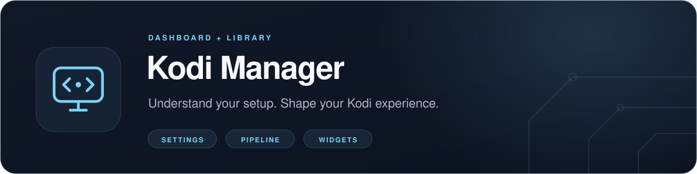
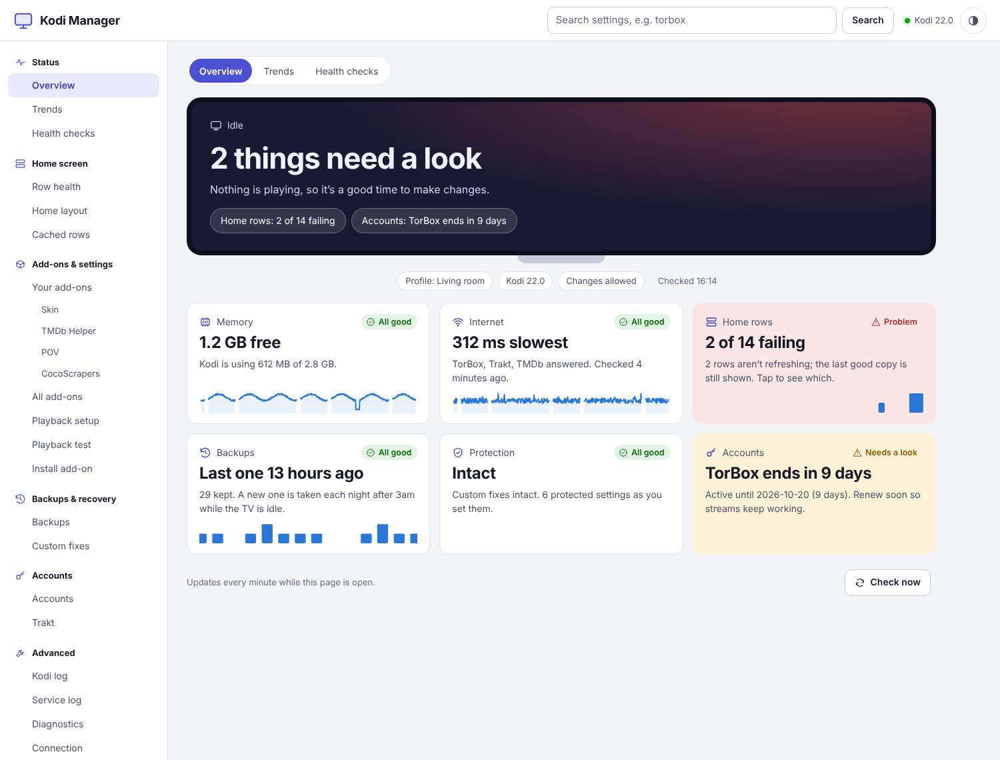
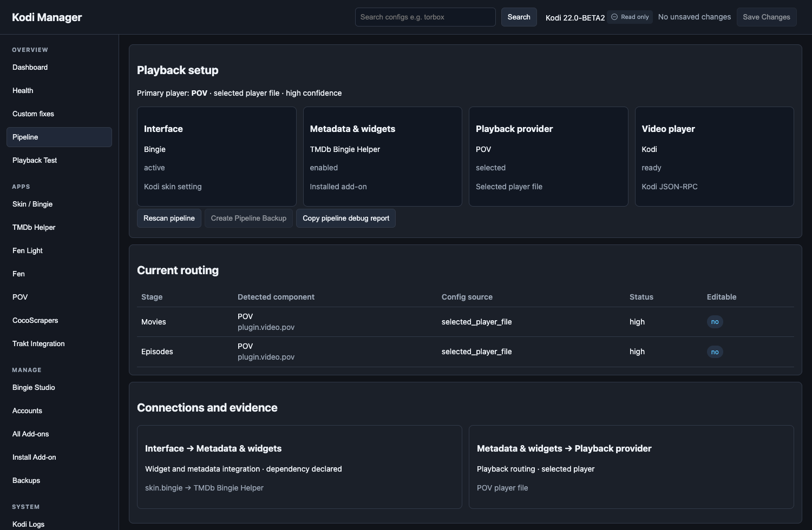

<p align="center">
  
</p>

<p align="center">
  <a href="https://github.com/glasgowm148/kodi-manager/actions/workflows/ci.yml"></a>
  <a href="https://github.com/glasgowm148/kodi-manager/releases"></a>
  <a href="pyproject.toml"></a>
  <a href="LICENSE"></a>
</p>

<p align="center">
  <a href="#what-you-can-do">Features</a> ·
  <a href="#quick-start">Quick start</a> ·
  <a href="#questions">Questions</a> ·
  <a href="#documentation">Documentation</a>
</p>

Inspect and configure Kodi from your browser. Kodi Manager is an add-on with a local dashboard
for status, add-on settings, playback routing, backups and home-screen rows. Use it from a phone or
computer, on its own or with [nvidia-MCP](https://github.com/glasgowm148/nvidia-MCP).



*Captured with synthetic demo data. No personal accounts, watch history or TV screenshots are included.*

> [!NOTE]
> Preview software. Targets Kodi 19+; cached rows need Kodi 20+. Live use is on one customized
> NVIDIA Shield. The current public ZIP and other hardware still need live validation;
> see [compatibility](docs/compatibility.md).

## What you can do

- Start with current issues and direct tasks for add-ons, home rows, playback, accounts and recovery.
- Inspect playback, memory, connection checks, account status and seven-day trends.
- Understand add-on purposes and dependencies, then edit supported settings with backups.
- Keep masked 24-hour logs across restarts, with grouped issues, explanations and recurrence after review.
- Trace the playback pipeline from skin and metadata helper to selected player.
- Create configuration checkpoints, restore them and undo restores.
- Serve optional [cached home-screen rows](docs/widget-cache.md).
- Preview and apply home layouts for reviewed Bingie / Skin Shortcuts sources.

<details>
<summary><strong>See the playback pipeline</strong></summary>



*Synthetic example: Bingie -> TMDb Bingie Helper -> POV. Detected relationships are separate from account authentication.*

</details>

## Quick start

Choose how you want to use Kodi Manager:

- **With an AI assistant**
  - Give your agent [one prompt for both](#one-prompt-for-both).
  - It sets up nvidia-MCP first, then installs and connects Kodi Manager.
  - You handle any TV permission prompts or steps the agent cannot complete.

- **With a browser only**
  - Follow the [TV remote setup steps](docs/setup.md#1-add-the-download-source--inside-kodi).
  - Add the repository inside Kodi, install Kodi Manager, then sign in from your phone or computer.
  - No agent, debugging or computer commands are needed.

Repository installs receive preview updates through Kodi's update settings.
Use the dashboard on a trusted home network and keep its access token private.

- **Need help?**
  - [Only Configure is available](docs/setup.md#only-configure-is-available).
  - [Installation or connection problems](docs/troubleshooting.md).
  - [Manual/offline ZIP installation](docs/setup-agent.md).

### One prompt for both

Copy this into an agent that can run commands and edit files on your computer.
No editing is needed; it asks for missing TV details and walks you through any TV prompts.

<details>
<summary><strong>Copy the complete setup prompt</strong></summary>

```text
Set up nvidia-MCP and Kodi Manager for my TV:
https://github.com/glasgowm148/nvidia-MCP
https://github.com/glasgowm148/kodi-manager

Read nvidia-MCP's docs/agent-setup.md and docs/companion.md first.
Ask for missing device/connection details and guide me through any TV preparation.

1. Install and configure nvidia-MCP on this computer. Verify the actual MCP
   connection can read my TV and Kodi before continuing.
2. Install Kodi Manager from https://glasgowm148.github.io/kodi-manager/
   using Kodi's native installer. Reuse supported existing installations and
   back up customizations before any replacement.
3. Connect the active profile's Manager token privately. Enable dashboard LAN
   access, give me its browser address, and verify read-only Manager access.

Handle computer commands, downloads and supported TV navigation yourself.
Ask me only for private credentials, pairing/permission prompts or TV steps
that your tools cannot complete. Keep passwords, tokens and pairing codes private.
Preserve my other MCP servers and settings. Target only my specified TV and
never interrupt playback. Enable only writes needed for setup; finish with
write mode and provider browsing off.
Complete both stages without asking me to send a second setup prompt.
```

</details>

## Questions

| Question | Answer |
| --- | --- |
| Do I need an AI agent or ADB? | The dashboard needs only Kodi and a browser. Both are optional for setup or automation. |
| Android boxes / Firestick? | Targets Android TV, Google TV and Android-based Fire OS. Physical validation is pending; Vega OS is unsupported. [Device guide](docs/setup.md#android-tv-and-fire-tv) |
| Apple TV? | Experimental dashboard, settings, widgets and reviewed skin workflows while Kodi is active. Physical validation is pending. [tvOS guide](docs/apple-tv.md) |
| Any skin or add-on? | General inspection works across skins; editing depends on the setting adapter and allowed add-ons. Home layout writes require reviewed source hashes. [FAQ](docs/faq.md) |

See the [FAQ](docs/faq.md) for write behavior, profile tokens, removal and support limits;
[troubleshooting](docs/troubleshooting.md) covers installation and connection failures.

<a id="optional-faster-home-screen-rows"></a>
Optional row caching, its measured results and undo steps are in the [widget cache guide](docs/widget-cache.md).

## For developers

The dependency-free Python 3.9+ library exposes `ManagerClient`, `parse_schema` and
`flatten_settings`. See the [library guide](docs/library.md) for installation and examples, the
[HTTP API](docs/api.md) for endpoints, and [Contributing](CONTRIBUTING.md) for tests and release checks.
Installing the library alone does not install the Kodi service.

## Documentation

The [documentation index](docs/README.md) covers all guides.

| I want to… | Guide |
| --- | --- |
| Install and sign in | [Setup](docs/setup.md) · [Troubleshooting](docs/troubleshooting.md) |
| Check device or skin support | [Compatibility](docs/compatibility.md) · [Apple TV](docs/apple-tv.md) |
| Configure home-screen rows | [Widget cache](docs/widget-cache.md) |
| Recover or upgrade | [Backups and recovery](docs/recovery.md) |
| Build an integration | [Python library](docs/library.md) · [HTTP API](docs/api.md) · [Private extensions](docs/extensions.md) |

[Contributing](CONTRIBUTING.md) · [Changelog](CHANGELOG.md) · [Security](SECURITY.md) · [MIT license](LICENSE).
Independent project; not affiliated with the Kodi Foundation, NVIDIA or any add-on author.
You supply your own add-ons and accounts.
