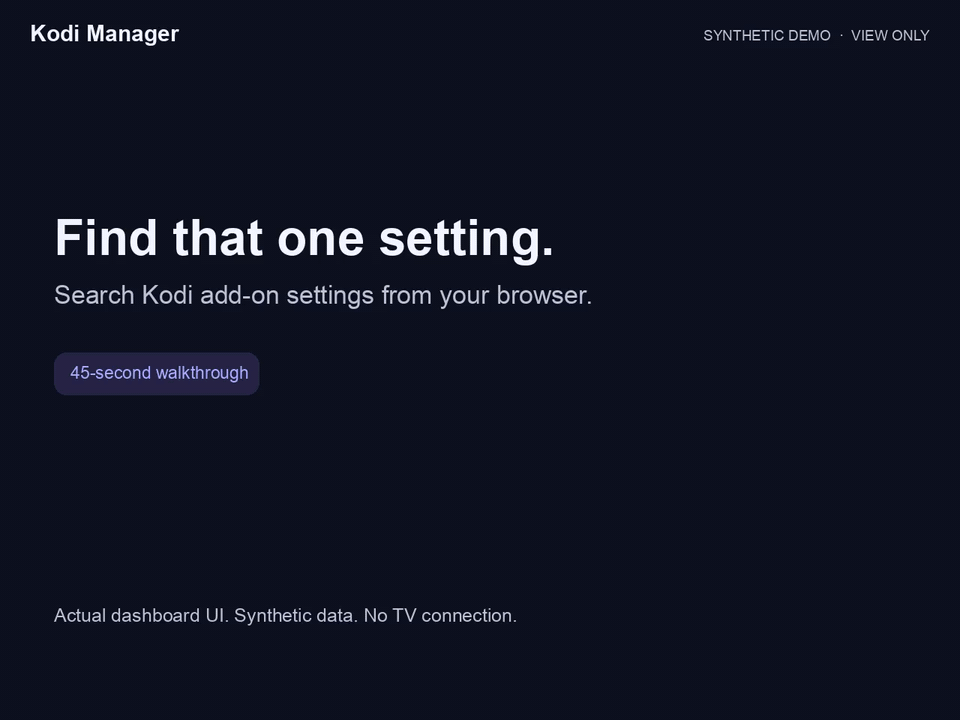

<p align="center">
  
</p>

<p align="center">
  <a href="https://github.com/glasgowm148/kodi-manager/actions/workflows/ci.yml"></a>
  <a href="https://github.com/glasgowm148/kodi-manager/releases"></a>
  <a href="pyproject.toml"></a>
  <a href="LICENSE"></a>
</p>

<p align="center"><a href="https://glasgowm148.github.io/kodi-manager/"><strong>Website &amp; practical guides</strong></a></p>

<p align="center">
  <a href="#what-you-can-do">Features</a> ·
  <a href="#quick-start">Quick start</a> ·
  <a href="#one-prompt-for-both">Agent setup prompt</a> ·
  <a href="#questions">Questions</a> ·
  <a href="#documentation">Documentation</a>
</p>

**Manage Kodi from your browser.** Search add-on settings, diagnose problems and restore backups
from your phone or computer. Kodi Manager also covers playback routing and home-screen rows.
Use the dashboard on its own or with [nvidia-MCP](https://github.com/glasgowm148/nvidia-MCP).

**Set up with an agent:** [Copy the guided setup prompt](#one-prompt-for-both).
It asks which TV you have and explains how to find its IP address.


*Captured with synthetic demo data. No personal accounts, watch history or TV screenshots are included.*

<details>
<summary><strong>Watch: find an add-on setting (45-second demo)</strong></summary>



[Download the shareable MP4](https://github.com/glasgowm148/kodi-manager/raw/refs/heads/main/docs/media/settings-demo.mp4) · [Text walkthrough and captions](docs/demo.md)

*Silent, edited capture of the real dashboard using synthetic data in view-only mode. No TV was connected.*

</details>

> [!NOTE]
> Preview software. Targets Kodi 19+; cached rows need Kodi 20+. Live use is on one customized
> NVIDIA Shield. The current public ZIP and other hardware still need live validation;
> see [compatibility](docs/compatibility.md).

## What you can do

- Start with current issues and direct tasks for add-ons, home rows, playback, accounts and recovery.
- Inspect playback, memory, connection checks, account status and seven-day trends.
- Understand add-on purposes and dependencies, then edit supported settings with backups.
- Keep masked 24-hour logs across restarts, with grouped issues, explanations and recurrence after review.
- Trace the playback pipeline from skin and metadata helper to selected player.
- Create configuration checkpoints, restore them and undo restores.
- Serve optional [cached home-screen rows](docs/widget-cache.md).
- Preview and apply home layouts for reviewed Bingie / Skin Shortcuts sources.

<details>
<summary><strong>See the playback pipeline</strong></summary>


*Synthetic example: Bingie -> TMDb Bingie Helper -> POV. Detected relationships are separate from account authentication.*

</details>

## Quick start

Choose how you want to use Kodi Manager:

- **With an AI assistant**
  - Give your agent [one prompt for both](#one-prompt-for-both).
  - It sets up nvidia-MCP first, then installs and connects Kodi Manager.
  - The agent explains how to find your IP and prepare the TV, then waits for your replies.

- **With a browser only**
  - Follow the [TV remote setup steps](docs/setup.md#1-add-the-download-source--inside-kodi).
  - Add the repository inside Kodi, install Kodi Manager, then sign in from your phone or computer.
  - No agent, debugging or Python installation is needed.

### One prompt for both

Use an assistant that can run commands, edit files and use local MCP tools on your computer.
Have Kodi installed, keep your TV remote handy, and connect the TV and computer to the same home network.

- **Copy and paste.**
  - Expand **Show the setup prompt to copy** below and copy the whole text box into your agent.
  - No editing is needed. **You do not need to know the TV's IP address yet.**
- **Follow the conversation.**
  - The agent asks which TV you have, then explains the relevant settings and IP-address menus.
  - Reply after each step. It waits for missing details and permission prompts before continuing.
  - One prompt starts the setup; you will still answer questions and use the TV remote when needed.

<details>
<summary><strong>Show the setup prompt to copy</strong></summary>

```text
Help me set up nvidia-MCP on this computer, then install and connect
Kodi Manager on my TV:
https://github.com/glasgowm148/nvidia-MCP
https://github.com/glasgowm148/kodi-manager

Read nvidia-MCP's docs/agent-setup.md and docs/companion.md first.
If not already known, first ask which TV/device I use. Do not assume I
know its IP address or have enabled debugging. Ask one short question
at a time. Explain the exact menus for my device, what to select and
what information to read back. Guide my device's TV preparation, including
debugging where applicable, finding its IP and enabling Kodi HTTP control.
For Apple TV, use the separate tvOS instructions. If a menu differs,
ask what I see. Wait for my reply before moving to the next TV step.
Do not invent connection details or scan my network.
Ask for the IP address on its own and wait for my answer. Only then ask
about a required port in a separate reply. Never request the IP and port
together, even as an optional extra. Ask about Kodi's HTTP port and any
Wireless debugging pairing port in separate replies too. Reuse details
I have already supplied.

Once TV preparation is ready:
1. Install and configure nvidia-MCP. Verify the actual MCP connection
   can read my TV and Kodi before continuing.
2. Install Kodi Manager from https://glasgowm148.github.io/kodi-manager/
   using Kodi's native installer. Reuse supported existing installations
   and back up customizations before any replacement.
3. Connect the active profile's Manager token privately. You cannot change
   Kodi Manager's own settings, so ask me to turn on Allow LAN access under
   Kodi Manager → Configure → Dashboard. Then give me its browser address
   and verify read-only Manager access.

Handle computer commands, downloads and supported TV navigation yourself.
Ask me for details or TV actions your tools cannot obtain or complete.
Request passwords, tokens and pairing codes only through private input.
Preserve my other MCP servers and settings. Target only my specified TV
and never interrupt playback. Enable only writes needed for setup;
finish with write mode and provider browsing off.
Continue both setup stages in this conversation, waiting for my replies
whenever information or permission is needed.
```

</details>

Repository installs receive preview updates through Kodi's update settings.
Use the dashboard on a trusted home network and keep its access token private.

- **Need help?**
  - [Only Configure is available](docs/setup.md#only-configure-is-available).
  - [Installation or connection problems](docs/troubleshooting.md).
  - [Manual/offline ZIP installation](docs/setup-agent.md).

## Questions

| Question | Answer |
| --- | --- |
| Do I need an AI agent or ADB? | The dashboard needs only Kodi and a browser. For assistant control, use the [guided setup prompt](#one-prompt-for-both). |
| Android boxes / Firestick? | Targets Android TV, Google TV and Android-based Fire OS. Physical validation is pending; Vega OS is unsupported. [Device guide](docs/setup.md#android-tv-and-fire-tv) |
| Apple TV? | Experimental dashboard, settings, widgets and reviewed skin workflows while Kodi is active. Physical validation is pending. [tvOS guide](docs/apple-tv.md) |
| Any skin or add-on? | General inspection works across skins; editing depends on the setting adapter and allowed add-ons. Home layout writes require reviewed source hashes. [FAQ](docs/faq.md) |

See the [FAQ](docs/faq.md) for write behavior, profile tokens, removal and support limits;
[troubleshooting](docs/troubleshooting.md) covers installation and connection failures.

<a id="optional-faster-home-screen-rows"></a>
Optional row caching, its measured results and undo steps are in the [widget cache guide](docs/widget-cache.md).

## For developers

The dependency-free Python 3.9+ library exposes `ManagerClient`, `parse_schema` and
`flatten_settings`. See the [library guide](docs/library.md) for installation and examples, the
[HTTP API](docs/api.md) for endpoints, and [Contributing](CONTRIBUTING.md) for tests and release checks.
Installing the library alone does not install the Kodi service.

### Verify a checkout

From the repository root, create an isolated environment and run the same checks used by CI:

```sh
python3 -m venv .venv
. .venv/bin/activate
python -m pip install --upgrade pip
python -m pip install -e '.[dev]'
python -m pytest -q
ruff check .
python -m build
```

The test suite uses synthetic Kodi files and loopback HTTP fixtures; it does not connect to a TV.
The build produces a wheel and source archive in `dist/`. Remove `dist/` before a release build if
you need to ensure that both artifacts were generated by the current checkout.

## Practical guides

- [Which Kodi tool fits my task?](https://glasgowm148.github.io/kodi-manager/kodi-manager-vs-kore-yatse-chorus/)
- [Edit add-on settings from a browser](https://glasgowm148.github.io/kodi-manager/edit-kodi-addon-settings-browser/)
- [Back up and restore add-on settings](https://glasgowm148.github.io/kodi-manager/backup-restore-kodi-settings/)

## Documentation

The [documentation index](docs/README.md) covers all guides.

| I want to… | Guide |
| --- | --- |
| Install and sign in | [Setup](docs/setup.md) · [Troubleshooting](docs/troubleshooting.md) |
| Check device or skin support | [Compatibility](docs/compatibility.md) · [Apple TV](docs/apple-tv.md) |
| Configure home-screen rows | [Widget cache](docs/widget-cache.md) |
| Recover or upgrade | [Backups and recovery](docs/recovery.md) |
| Build an integration | [Python library](docs/library.md) · [HTTP API](docs/api.md) · [Private extensions](docs/extensions.md) |

[Contributing](CONTRIBUTING.md) · [Changelog](CHANGELOG.md) · [Security](SECURITY.md) · [MIT license](LICENSE).
Independent project; not affiliated with the Kodi Foundation, NVIDIA or any add-on author.
You supply your own add-ons and accounts.
